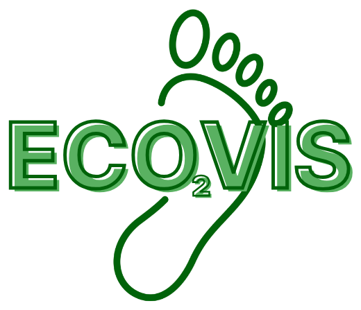

# ECOVIS



**ECOVIS** helps you see the good in green and energy-efficient reinforcement learning. It is an interactive energy analysis platform that shows how much energy tabular RL agents (Q-learning, SARSA and Double Q-learning) use while they learn to solve travelling salesman problems from TSPLIB.

ECOVIS was born out of a simple idea: to raise awareness about the energy consumption of machine learning, whose environmental impact often goes unnoticed. It is meant to be simple, intuitive and insightful, so that users understand their results and also think about the energy behind them.

Pick a configuration and the page replays its 1,000 episodes. For each episode it shows **duration, CPU / RAM / total energy and CO₂ emissions** (time series and running totals) alongside **performance**: tour distance and the best values found so far.

Nothing is trained or measured in the browser; the page only reads the dataset in `data/`.

## Running

**Online:** https://sams-santos.github.io/RL-Green-Interface/

**Locally:** open `index.html` in a browser. No server or build step is needed (D3 is loaded from a CDN). The run data is compressed, so the browser must support `DecompressionStream`: Chrome or Edge 80+, Firefox 113+, Safari 16.4+.

The URL keeps the current view (tab, run, episode, Energy or Performance, country), so a view can be shared by link (e.g. `#tab=concepts`).

## Tabs

The views are listed in the menu on the left; each opens under a title bar that also shows the playback status. A visit without a run in the URL starts at Initial setup. The look (olive page, sage frame, cream cards, dark-green buttons, yellow verdict card) follows the first version of ECOVIS, built for machine-learning models by Laís C. Medeiros and Samara Santos through a design study with expert interviews ([Santos et al., CGVC 2026](https://doi.org/10.2312/cgvc.20261003)), and adapted here to reinforcement learning.

**Initial setup.** The run opened in Explore (algorithm, instance, reward, decay, ε₀, γ, α, seed; options with no run are marked ∅), the electricity grid (country) and the energy unit (joules or watt-hours), used in every view.

**Explore a run.** Replay the episodes of the run chosen in Initial setup:

- **Chips** at the top summarise the selected run (algorithm, instance, reward, decay, ε₀, α, γ); *Change* opens Initial setup.
- The **playback bar** plays the episodes or jumps to one, sets the speed, switches the charts between *per episode* and *cumulative* values, and marks an episode that sets a new best.
- Two views split the results; only the open one is drawn. Each starts with the ECOVIS score next to its summary, then three charts: one large and two small below it. Click a small chart to show it large.
  - **Energy**: the energy board (elapsed time, CPU/RAM split, CPU + RAM = E, E × C = CO₂eq, each value for the episodes shown so far with the whole run's total below it); energy, emissions and duration per episode; the emissions map; and what the run adds up to if repeated every day;
  - **Performance**: best distance, gap to optimum, current distance and improvements; distance per episode, gap to optimum per episode, and the running count of new best tours.
- Every chart has axis titles, and its unit is shown next to its title. Energy is shown in joules (or watt-hours) and emissions in grams of CO₂eq, with the SI prefix that suits each value (20.2 J, 36 mJ, 1.63 mg), so no number needs scientific notation.
- **Colour-blind palette** (button under the menu) swaps every colour that carries meaning for the palette of Okabe and Ito ([Color Universal Design](https://jfly.uni-koeln.de/color/)), on every tab and in the exported report: series in blue, vermillion and sky blue; ratings from blue (A) through yellow (C) to vermillion (E); the map from yellow through bluish green to blue; buttons, sliders and icons in blue; the best tour highlighted in orange; energy tiles in a bluish-green tint and emissions tiles in a sky-blue tint. Only the neutral olive and cream frame stays. The choice is remembered in the browser.
- *Export report* saves the run up to the current episode as HTML or PDF.
- The **ECOVIS score** (0–100, rating A–E) follows the efficiency index, compound score and rating of Fischer et al. ([ECML PKDD 2022 workshops](https://doi.org/10.1007/978-3-031-23618-1_3); STREP, [Data Min Knowl Disc 2024](https://doi.org/10.1007/s10618-024-01020-3)). Against the 8,640 runs on the same instance, each property becomes an index p = best value on the instance ÷ this run's value (tour length and total energy); the score is 100 × ((1 − w) · p_tour + w · p_energy), with w set by the *What matters more?* slider (0.5 by default, as in STREP); ratings A–E split each index and the score at the 20/40/60/80 % quantiles. The energy rating is the run's **energy label**. The Concepts & references tab explains the calculation with a worked example.

**Compare two runs.** Pick run A and run B (any two configurations):

- A slider sets the number of episodes to compare; the grid and units come from Initial setup.
- **ECOVIS score** cards for A and B, with a verdict ("B is the greener choice: 17% less energy and a 60% shorter tour", or the trade-off) and what the energy difference adds up to if the run were repeated daily for a year. A button compares A with the highest-scoring run on its instance.
- A summary table shows the difference of B relative to A; ✓ marks the lower (better) value.
- Line charts overlay best distance, distance per episode, cumulative energy and cumulative emissions.

**Concepts & references.** A short, illustrated text on the ideas behind the platform, one section at a time (pick it in the contents list):

- why the energy of learning is measured (Green AI);
- reinforcement learning, with Q-learning, SARSA and Double Q-learning;
- the settings α, γ, ε, epsilon decay, reward and seed;
- the TSP as an RL problem, TSPLIB and the gap to optimum;
- how energy is measured (RAPL, RAM estimate, tracking mode);
- CO₂eq and carbon intensity;
- the everyday comparisons and how to read the charts.

Each claim cites a numbered reference: the author's publications, the original papers and the data sources. A citation link opens the References section at that reference, without changing the URL.

There is one set of grid and unit controls, in Initial setup, shared by the Explore and Compare tabs. Icons mark every metric, and the same quantity always has the same icon (for example, a lightning bolt for energy and a cloud for emissions).

## Report

**Export report** (Explore tab) builds a report of the selected run, from its first episode to the current one. It uses the choices currently set on the page: per-episode or cumulative charts, units and country. The configuration and the measurement method are always included. You choose the other sections:

- energy & emissions summary;
- energy, emissions and duration charts;
- emissions by country (map and table);
- everyday equivalents and the daily projection, with sources;
- performance summary;
- distance chart;
- history of new best distances.

**Print / save as PDF** opens the report and the print dialog. **Download HTML** saves a self-contained file.

## Emissions by country

```
CO₂eq = E × C
```

- **E** is the energy consumed, in kWh.
- **C** is the carbon intensity of the electricity, in g CO₂eq/kWh.

The **Electricity grid** control (in Initial setup) offers:

- **As measured in the experiment.** This uses the emissions recorded in the data.
- **Any of 212 countries.** This recomputes the emissions from the measured energy, using the country's C.

`data/global_energy_mix.json` holds, for each country (keyed by ISO 3166 alpha-3), its name, its alpha-2 code (for the flag), its carbon intensity and the year of the data. Countries without a carbon intensity are not included.

### Emissions map

Each country is coloured by the emissions this run would have produced on its grid.

- **Colours.** There is one step per 100 g CO₂eq/kWh, from mint (cleanest) to plum (most carbon-intensive). Each step is darker than the one before, so the scale can be read without colour vision.
- **Small countries.** Countries too small for the map are drawn as dots. Countries with no data are hatched.
- **Interaction.** Hover over a country to see its values. Click it to use its grid.
- **Summary.** Cards to the right of the map show the cleanest grid, the selected one and the most carbon-intensive one. A sentence says how many times more the same run emits on the dirtiest grid than on the cleanest.

## Everyday equivalents

**If you ran this every day** (Energy view) covers the episodes shown so far and repeats the same amount daily for a month (30 days) and a year (365 days), next to familiar activities: phone charges, AI prompts, electric and petrol car distance, video streaming and the time a tree takes to absorb it. Emissions comparisons follow the selected country. The exported report also lists each comparison for the run itself.

Each comparison is one division: amount ÷ factor. `data/equivalents.json` keeps, for each factor, the value exactly as published, the normalised factor, its source and its icon:

| Comparison | Published value | Source |
|---|---|---|
| Full smartphone charge | 0.019 kWh per charge | [US EPA, GHG Equivalencies Calculator](https://www.epa.gov/energy/greenhouse-gas-equivalencies-calculator-calculations-and-references) |
| AI text prompt (median Gemini) | 0.24 Wh per prompt | [Elsworth et al. 2025, arXiv:2508.15734](https://arxiv.org/abs/2508.15734) |
| Electric car | 0.17 kWh/km | [EcoLogits Calculator](https://github.com/genai-impact/ecologits-calculator/blob/942e218903142041f5cfd6f078da7b4c0bb677af/src/config/constants.py) (Selectra, Tesla) |
| Petrol car | 142 g CO₂eq/km | EcoLogits Calculator (ADEME Impact CO₂) |
| Video streaming | 15.6 h per kg CO₂eq | EcoLogits Calculator (ADEME Impact CO₂) |
| Urban tree absorbing CO₂ | 0.060 t CO₂ per tree per year | US EPA |

Sources were retrieved on 2026-10-09.

## Configuration space

The dataset covers every combination below: 3 × 8 × 5 × 3 × 8 × 8 × 3 = **69,120 runs** of 1,000 episodes each, all with seed 42.

| Parameter | Values |
|---|---|
| algorithm | `sarsa`, `q-learning`, `double-qlearning` |
| instance | `eil51`, `berlin52`, `st70`, `kroA100`, `tsp225` (TSP); `br17`, `ftv33`, `ftv64` (ATSP) |
| epsilon_decay | `linear`, `convex`, `concave`, `step`, `fixed` |
| reward | `R1`, `R2`, `R3` |
| gamma, alpha | `0.01`, `0.15`, `0.30`, `0.45`, `0.60`, `0.75`, `0.90`, `0.99` |
| epsilon_init | `0.01`, `0.05`, `0.10` |
| seed | `42` |
| episodes | 1,000 per run, numbered 0–999 |

In this dataset `step` never lowers ε within the 1,000 episodes (`epsilon_final` = ε₀ in every summary), so its 13,824 runs reach the same best distances as `fixed`.

The options come from the data (`data/manifest.js`). A combination with no run is marked ∅, and selecting it lists the closest runs that exist.

## Dataset

The runs were produced by the training code in [Energy-Comparison-of-Three-RL-Algorithms](https://github.com/sams-santos/Energy-Comparison-of-Three-RL-Algorithms):

- **Rewards:** R1 = 1/d, R2 = −d and R3 = −d², where d is the length of the move.
- **Training:** Q-tables start at zero, and each episode starts from a random city.
- **Measurement:** energy is measured with CodeCarbon 3.3.1. Each episode is wrapped in `start_task` / `stop_task`, so its energy is the difference between two RAPL readings. The tracker runs offline with the Irish grid, in machine mode, with `rapl_include_dram` and `rapl_prefer_psys` turned on.

The results are attached to the GitHub release `data-runs-v1`, one pair of files per algorithm and instance:

- `<name>_<instance>_master_episodes.csv.gz`: one row per episode;
- `<name>_<instance>_master_summary.csv`: one row per run.

To rebuild `data/runs/` and `data/manifest.js`:

```bash
python tools/fetch_release.py <download folder>     # about 5.4 GB; keep it outside cloud-synced folders
python tools/build_dataset.py <download folder>     # about 10 minutes
```

The repository is public, so `fetch_release.py` needs no sign-in (it sends `GITHUB_TOKEN` with the release query if it is set, for a higher rate limit).

**Episode files** have one row per episode. They are read with these columns:

| Column | Meaning |
|---|---|
| `run_index`, `algorithm`, `instance`, `r_type`, `e_type`, `epsilon_init`, `gamma`, `alpha` | identify the run (`q_learning` → Q-learning, `double_q` → Double Q-learning, `berlin52.tsp` → berlin52) |
| `episode`, `epsilon` | episode number (0–999) and its exploration rate |
| `distance` | tour length |
| `Duration_sec` | seconds |
| `CPU_Energy_kWh`, `RAM_Energy_kWh` | kWh |

**Summary files** have one row per run, matched to the episodes on the columns that identify it. They provide:

- the seed and the number of episodes;
- the totals, the best distance and the episode where it was found;
- the carbon intensity;
- the average CPU and RAM power;
- the measurement method (`cpu_measurement`, `tracking_mode`).

The converter checks every run against its summary: the best distance and best episode must match.

**What is stored.** Total energy is exactly CPU + RAM, and emissions are exactly energy × carbon intensity, so neither is stored. Each ε schedule depends only on the decay and ε₀, so the 15 schedules are kept once in the manifest. Distances are kept exactly. Durations and energies are kept on a logarithmic scale with about 0.1% relative error. The columns are compressed (zlib) and unpacked in the browser.

**Shards.** Runs are stored in 1,080 shards, `data/runs/<algorithm>/<instance>/<reward>_<decay>_e<ε₀>_s<seed>.js`. Each shard holds the 64 α × γ runs of one setting, with their summaries, and is loaded only when one of its runs is opened. Together they take about 560 MB.

## Reference data

| Command | Reads | Writes |
|---|---|---|
| `python tools/build_reference.py` | `data/instances/`, `data/global_energy_mix.json`, `data/equivalents.json` | `data/reference.js` |
| `python tools/build_world.py` | Natural Earth admin-0 countries v5.1.2 (downloaded) | `data/world.js` |

Run them again after changing their inputs. An equivalent's `icon` and `badge` must be names from `js/icons.js`.

## Project layout

```
index.html                   page (Explore, Compare, and Concepts & references tabs)
assets/                      ECOVIS logo and favicon
css/style.css                flat, light pastel theme (chart colours checked for colour-blind readers)
js/config.js                 parameter grid and run ids
js/data.js                   on-demand run loading and derived series
js/charts.js                 D3 charts: time series and world map (all 2D), SI-prefix formatting
js/icons.js                  Lucide line icons used by the page
js/equivalents.js            everyday comparisons
js/scores.js                 ECOVIS score, energy labels and their views
js/report.js                 report builder
js/compare.js                Compare tab
js/main.js                   page controller and Explore tab
data/instances/              TSPLIB instance files
data/global_energy_mix.json  carbon intensity per country
data/equivalents.json        everyday comparison factors and sources
data/reference.js            generated: instances, countries, equivalents
data/world.js                generated: country shapes
data/manifest.js             generated: parameter grid, shard list, ε schedules
data/runs/                   generated: one shard per setting (64 α × γ runs)
data/summaries/              generated: one file per instance (8,640 runs), about 130 kB each
tools/fetch_release.py       downloads the release files
tools/build_dataset.py       release files -> data/runs, data/manifest.js (then runs build_summaries.py)
tools/build_summaries.py     data/runs -> data/summaries (best distance and energy of every run, for the ECOVIS score)
tools/build_reference.py     -> data/reference.js
tools/build_world.py         -> data/world.js
```

## License

[](https://creativecommons.org/licenses/by-nc-sa/4.0/)

© 2026 Samara Santos. Based on the first version of ECOVIS by Laís C. Medeiros and Samara Santos, who created its name, logo and visual design ([Santos et al., CGVC 2026](https://doi.org/10.2312/cgvc.20261003)). Licensed under [Creative Commons Attribution-NonCommercial-ShareAlike 4.0 International](https://creativecommons.org/licenses/by-nc-sa/4.0/). See [LICENSE](LICENSE) for the full text.

- **Use, share and adapt freely** for non-commercial purposes.
- **No commercial use.** You may not sell this work or anything derived from it, or use either to make a profit.
- **Same license for derivatives.** Anything built from this work must be released under CC BY-NC-SA 4.0.
- **Always credit the original**, for example:

  > Based on *ECOVIS* by Samara Santos (first version by Laís C. Medeiros and Samara Santos), https://github.com/sams-santos/RL-Green-Interface, licensed under CC BY-NC-SA 4.0.

Third-party material keeps its own terms (see [LICENSE](LICENSE)): the TSPLIB instance files, the CodeCarbon energy-mix data, D3.js, flag-icons, the Lucide icons (ISC) and the Natural Earth map data (public domain).
